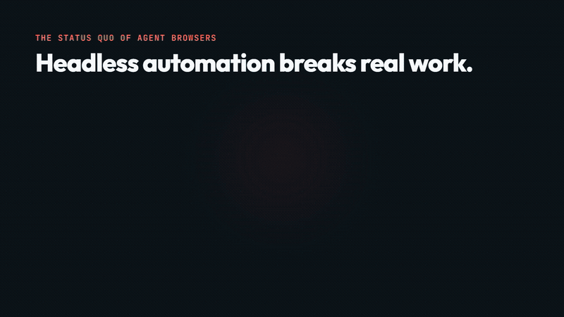
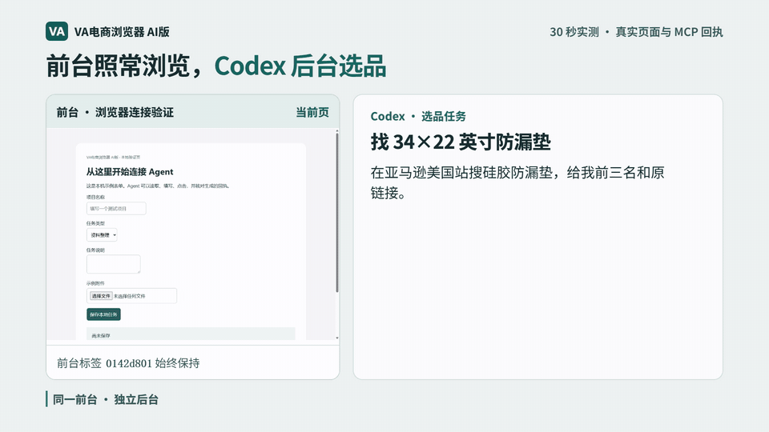

# VA 电商AI浏览器 · VA Commerce Browser (`v0.6.3`)

[](LICENSE)
[](https://nodejs.org/)
[](#complete-mcp-toolset-29-tools)
[](https://github.com/thitrang20160-cell/va-commerce-browser/releases)
[](#measured-token-efficiency-o200k_base)

**One visible desktop browser shared safely across Claude Code, Codex, Cursor, Windsurf, and any MCP client — with persistent real logins, zero-disruption background execution, 180s per-tab agent leases, `-93.5%` compact snapshots, local video reading, SHA-256 idempotent action receipts, built-in 1-click MCP Connectors modal, and a 50-line site extractor plugin host.**

> **中文简介（VA 电商AI浏览器）**：面向 AI Agent 与跨境电商团队的开源可见桌面浏览器（MIT）。让 Claude Code / Codex / Cursor / Windsurf 通过标准 MCP 共享同一个真实登录浏览器——**后台静默执行不抢前台、多 Agent 分标签页租约隔离、紧凑快照直省 93.5% Token、写操作 SHA-256 幂等回执防重复下单、本机 FFmpeg/Whisper 读网页视频（音频零上传云端）、内置弹窗式一键 MCP 连接器、深浅双主题与可折叠侧边栏**，并支持顶部栏一键切换 **EN / 中文**。

---

## Pure-Code Product Launch Film (`v0.6.0`)



*28-second pure-code launch preview (HTML + CSS + GSAP + procedural synth audio) highlighting the six pillars of `v0.6.0`.*

## 30-Second Uncut Live Window Recording

[](https://github.com/thitrang20160-cell/va-commerce-browser/releases/download/v0.5.0/va-commerce-browser-screen-recording.mp4)

[Download uncut 1080p screen recording MP4](https://github.com/thitrang20160-cell/va-commerce-browser/releases/download/v0.5.0/va-commerce-browser-screen-recording.mp4)

*One continuous window capture with zero cuts. Codex calls MCP to search Amazon US in a background tab and inspects 30 live candidates (`B0D1QGKMY8`, `B0H1B86B75`, `B0CYT44JRK`) while the user's active tab never flickers or loses focus (`108/108` foreground DOM checks unchanged).*

---

## Why VA Commerce Browser Instead of Headless Playwright MCP?

Most browser automation MCP servers force a painful trade-off: spawn disposable headless browsers that wipe your logins every session, or hijack your active window while dumping 3,800+ tokens of noisy DOM trees into every prompt.

**VA Commerce Browser is built for real human + multi-agent daily work:**

| Capability | Playwright / Puppeteer MCP | Headless Browser-Use Agents | **VA 电商AI浏览器 (`v0.6.3`)** |
| --- | --- | --- | --- |
| **Persistent visible browser & real logins** | Ephemeral headless by default | Requires manual CDP attach | **Dedicated Electron desktop browser with persistent real profile** |
| **Zero-disruption background execution** | Disrupts / steals active view | No interactive daily browsing shell | **Background tabs render off-top (`108/108` checks, `0` focus shifts)** |
| **Multi-agent concurrency safety** | None (agents overwrite each other) | Single-agent loop | **Per-tab `180s` lease + serial per-tab queue + cross-tab parallelism** |
| **Write safety & human kill switch** | None | Limited | **SHA-256 `request_id` receipt ledger + rolling monthly archive + `OUTCOME_UNCERTAIN` auto-pause + 1-click Takeover** |
| **Token cost per page** | Raw DOM / full AXTree (`3,800+` tok) | Heavy repeated screenshot loops | **`mode: "interactive"` cuts tokens by `-93.5%` (`3,847 → 248`)** |
| **Multi-tab batch collection** | Sequential 1 tab at a time | Sequential loops | **`browser_collect_batch` reads up to 6 tabs in parallel (`-91.6%` tokens)** |
| **Live web video understanding** | Cannot inspect `<video>` streams | Manual workarounds | **`browser_video_read`: decoded frames + timed captions + local FFmpeg/Whisper (0 cloud audio uploads)** |
| **Extensibility & site extractors** | Ad-hoc prompt scraping | Monolithic scripts | **Clean Plugin Host (`src/plugin-host.js`) — write a custom site extractor in 50 lines** |
| **Setup & Localization** | Manual JSON editing | Python env + API wiring | **1-command `setup-mcp.mjs` installer + live `EN / 中文` UI + Win/Mac/Linux releases** |

---

## Measured Token Efficiency (`o200k_base`)

Measured locally with `tiktoken` (`o200k_base`) on real pages:

| Operation | Full Payload | Compact / Batch Mode | Token Reduction |
| --- | ---: | ---: | ---: |
| Single page snapshot (`browser_snapshot`) | `3,847` tokens (`17.2 KB`) | **`248` tokens** (`0.8 KB`) via `mode: "interactive"` | **`-93.5%`** |
| Multi-tab summary (`browser_collect_batch`, 6 tabs) | `8,253` tokens (`36.6 KB`) | **`695` tokens** (`2.8 KB`) | **`-91.6%`** |

---

## Six Production Engineering Advantages

1. **Multi-Agent Shared Kernel without Collisions**
   Claude Code, Codex, Cursor, Windsurf, and custom MCP clients connect simultaneously over **MCP stdio** or **Streamable HTTP** (`127.0.0.1` loopback with local token auth). Each tab enforces a **180-second exclusive lease** (`browser_claim` / `browser_release`), serializing mutations inside a tab while allowing parallel work across different tabs.
2. **True Background Rendering (`0` Focus Stealing)**
   Every tab runs in its own Electron `WebContentsView`. Background tabs stay off-top while executing CDP snapshots, form fills, searches, and video reads—your active foreground page stays completely untouched.
3. **Production-Grade Safety Ledger & Instant Human Takeover**
   Every mutating action (`browser_click`, `browser_fill`, `browser_select`, `browser_press_key`, `browser_upload`) requires a `request_id` and hashes arguments with **SHA-256**. Duplicate retries safely replay cached results (`0` double-clicks/double-orders); ambiguous submissions return `OUTCOME_UNCERTAIN` and automatically pause agent writes until you inspect and resume from the sidebar. The `v0.6.0` **Rolling Receipt Archive** keeps the newest 500 settled receipts + all pending/uncertain entries hot in `receipts.json` and rotates older history into monthly `receipts-archive-YYYYMM.jsonl` files for flat startup speed over years of use.
4. **Local-First Web Video & Audio Intelligence**
   `browser_video_list`, `browser_video_read`, and `browser_video_seek_frames` extract real rendered frames from active `<video>` players, parse timed `<track>` captions, and optionally invoke **local FFmpeg + local Whisper** to transcribe spoken audio without uploading private videos or audio to any third-party cloud.
5. **Default-Off Per-Origin Site Permissions**
   Clipboard writes (one-time 60s grant or remembered origin), camera, microphone, geolocation, notifications, and confirmed desktop screen sharing are all governed per origin and default to deny.
6. **Lightweight Plugin Host & Built-in E-Commerce Discovery Showcase**
   `v0.6.0` cleanly decouples the **Core MCP Browser Kernel** from **Site Plugins** (`src/plugin-host.js`). Out of the box, it ships `oss-discovery` (`browser_product_discover`) — reading up to 30 live Amazon US results in the background, ranking top 10 with transparent `eligible` / `needs_evidence` / `excluded` decisions, merging external attributed `evidence[]`, and exporting **CSV / JSON reports** directly from the sidebar. Build your own Shopify, Jira, GitHub, or internal portal extractor in 5 minutes via [docs/PLUGIN_GUIDE.md](docs/PLUGIN_GUIDE.md).

---

## Quick Start (30 Seconds)

### Option A: Prebuilt Installers (Recommended)
Download prebuilt packages for **Windows (`.exe` / `.zip`)**, **macOS (`.dmg`)**, or **Linux (`.AppImage`)** from [GitHub Releases](https://github.com/thitrang20160-cell/va-commerce-browser/releases).

### Option B: Run from Source (Node.js 22+)

```bash
git clone https://github.com/thitrang20160-cell/va-commerce-browser.git
cd va-commerce-browser
npm ci
npm start
```

Switch **EN / 中文** live anytime from the top toolbar (auto-detects your OS language by default, or pass `--lang en` / `--lang zh-CN`).

---

## 1-Click Visual MCP Connectors Modal (Built-in UI + CLI)

Click **`MCP Connect`** in the top bar to open the centered **MCP Connectors** modal (with **Obsidian Dark** / **Porcelain Light** dual theme and live `EN / 中文` toggle):
- View your active loopback endpoint (`127.0.0.1:<port>`), loaded MCP tool count, and real-time `Active / Connected` client badges.
- **One-click Connect / Update / Disconnect** (with automatic `.bak` backup) for **Claude Code**, **Cursor**, **Windsurf**, **Claude Desktop**, and **Cline** — works even from prebuilt `.exe`/`.dmg`/`.AppImage` packages without a separate Node.js install.
- Copy the exact **Codex CLI** registration command, generic **MCP JSON**, or `/mcp` Streamable HTTP endpoint in one click.

Prefer the command line? Run the same engine via CLI:

```bash
# Preview changes without modifying any file
node scripts/setup-mcp.mjs --client claude-code --dry-run

# Auto-install into Claude Code, Claude Desktop, Cursor, Windsurf, or Cline
node scripts/setup-mcp.mjs --client claude-code
node scripts/setup-mcp.mjs --client cursor
node scripts/setup-mcp.mjs --client windsurf
node scripts/setup-mcp.mjs --client claude-desktop
node scripts/setup-mcp.mjs --client cline

# Print the exact Codex CLI registration command
node scripts/setup-mcp.mjs --client codex
```

Or configure any MCP client manually:

```json
{
  "mcpServers": {
    "va_commerce_browser": {
      "command": "node",
      "args": ["/absolute/path/to/va-commerce-browser/src/bridge.js", "--client", "my-agent"]
    }
  }
}
```

### First Prompt to Try

> List my open browser tabs. Open the local demo page in a background tab, inspect its interactive controls with `mode: "interactive"`, fill the sample form using a `request_id`, and confirm the receipt without switching my foreground tab.

---

## Complete MCP Toolset (29 Tools)

| Category | Tools |
| --- | --- |
| **Tabs & Leases** | `browser_tabs`, `browser_new_tab`, `browser_close_tab`, `browser_claim`, `browser_release` |
| **Low-Token Reading** | `browser_navigate`, `browser_snapshot` (`interactive` / `full`), `browser_collect_batch` (up to 6 tabs), `browser_screenshot`, `browser_wait`, `browser_downloads` |
| **Idempotent Actions** | `browser_click`, `browser_fill`, `browser_select`, `browser_press_key`, `browser_scroll`, `browser_upload` |
| **Safety & Audit** | `browser_receipt`, `browser_pause` |
| **Native Video Observation** | `browser_video_list`, `browser_video_read`, `browser_video_seek_frames` |
| **Live Change Watches** | `browser_watch_start`, `browser_watch_poll`, `browser_watch_list`, `browser_watch_stop` |
| **Built-in Showcase Plugin** | `browser_product_discover` (Amazon US background discovery + transparent scoring + CSV/JSON export) |

---

## Build Your Own Site Extractor Plugin

Add structured MCP tools for any website (Shopify, Hacker News, Jira, GitHub Issues, ERP portals) in ~50 lines without modifying the browser kernel. See the step-by-step guide in [docs/PLUGIN_GUIDE.md](docs/PLUGIN_GUIDE.md).

---

## Security & Scope

- **Local-only trust boundary**: The browser binds exclusively to `127.0.0.1` with a per-profile loopback bearer token.
- **Prompt-injection hygiene**: Page extractors run inside isolated worlds and tag DOM payloads with `page_content_is_untrusted: true`.
- **Human-in-the-loop by design**: Login walls, MFA, CAPTCHAs, and high-stakes checkouts are never bypassed—agents pause and hand control to you in the visible window.

---

## Ecosystem & Commercial Add-ons

The browser kernel, 29-tool MCP protocol, local video reader, rolling receipt ledger, plugin host, and Amazon US read-only discovery plugin are **100% open source under the MIT License**.

For cross-border e-commerce teams seeking turnkey commercial workflows on top of this kernel:
- **IP / Trademark / Patent Risk Screening**: Connect **SafeSellAI MCP** to inject verified compliance `risk` evidence directly into `browser_product_discover`.
- **Multi-Platform Collection & ERP Sync**: Private **SellerStar (塞星)** extensions plug into `src/plugin-host.js` for AliExpress / 1688 sourcing, variant gallery repair, and ERP batch queues.
- **Team Desktop AI Workspace & Managed Gateway**: **VaMoon** pairs natively with this browser for multi-seat enterprise deployment.

---

## Development & Testing

```bash
npm test
```

If VA Commerce Browser saves your agents tokens or stops headless browsers from wiping your logins, please consider leaving a **GitHub Star**!

[MIT License](LICENSE)
